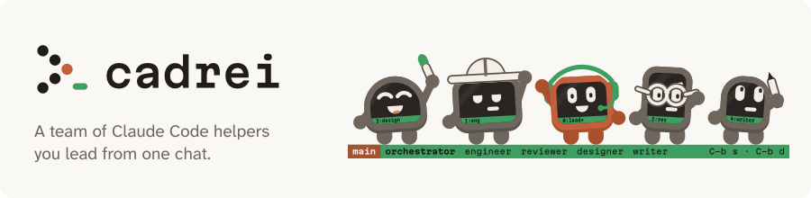
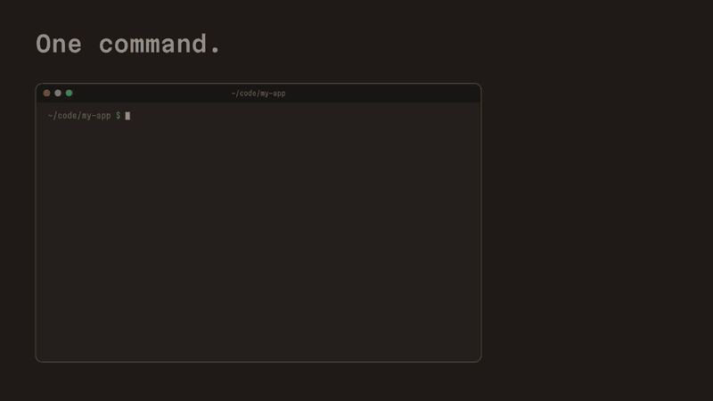
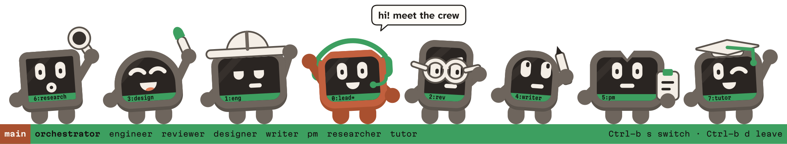

<picture>
  <source media="(prefers-color-scheme: dark)" srcset="docs/brand/header-dark.svg">
  
</picture>

# Cadrei

**A team of Claude Code helpers you lead from one chat.**

Run `cadrei` and you get one chat with your **orchestrator**. It hands your work to **team members**, other Claude Code sessions that each do one job and pick up where they left off. Dev, research, study, job search: if you can describe a team, you can have one.

**Docs and guide: [cadrei.dev](https://cadrei.dev)**



## Install

```bash
brew install rafi-ramdhani/cadrei/cadrei
```

No Homebrew? Run `curl -fsSL --proto '=https' https://raw.githubusercontent.com/rafi-ramdhani/cadrei/main/install.sh | sh` instead.

You'll need macOS or Linux, [Claude Code](https://claude.com/claude-code), git, and tmux 3.2 or newer (Homebrew installs tmux for you).

Then run `cadrei` in a repo you want your team to work on, and press Enter. That's it. From there, you just talk to your orchestrator.

## Meet the crew

<picture>
  <source media="(prefers-color-scheme: dark)" srcset="docs/brand/crew-dark.svg">
  
</picture>

You start with an engineer and a reviewer. Want a designer, a writer or a tutor? Just ask. Each member is its own Claude Code session and uses your Claude plan like one, so your orchestrator only starts the ones a task needs.

Answer your team's questions and permission prompts from the orchestrator: no trips to each member's window.

## Learn more

- [Getting started](https://cadrei.dev/docs/): install, run it in a repo, and press Enter
- [Command reference](https://cadrei.dev/docs/commands/): every command, for when you want to do it by hand
- [Permissions](https://cadrei.dev/docs/permissions/): let your team run exact commands without asking you each time
- [Backup and restore](https://cadrei.dev/docs/backup/): back up your crew to GitHub and bring it back on another machine
- [Uninstall and restore](https://cadrei.dev/docs/uninstalling/): remove cadrei and keep your crews, or pack everything away and restore it later
- [For tool builders](https://cadrei.dev/docs/tools/): read your crew's state from your own app
- [New to tmux?](https://cadrei.dev/docs/new-to-tmux/): the few keys you need

## Project

- [Changelog](CHANGELOG.md)
- [Security policy](SECURITY.md)
- [Contributing](CONTRIBUTING.md)

The code and text are under the [MIT license](LICENSE). The brand art is not: the logo, the characters and the lead's terminal art are Copyright (c) 2026 Rafi Ramdhani Azis, all rights reserved, not covered by the MIT license. [NOTICE](NOTICE) lists its files. Cadrei (say it CAD-ray) is an independent project, not affiliated with or endorsed by Anthropic.

[](https://github.com/rafi-ramdhani/cadrei/actions/workflows/ci.yml)
